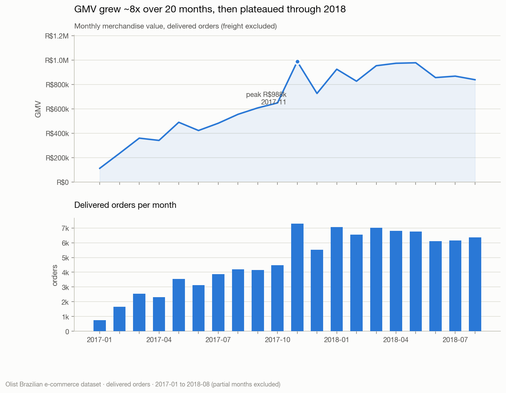
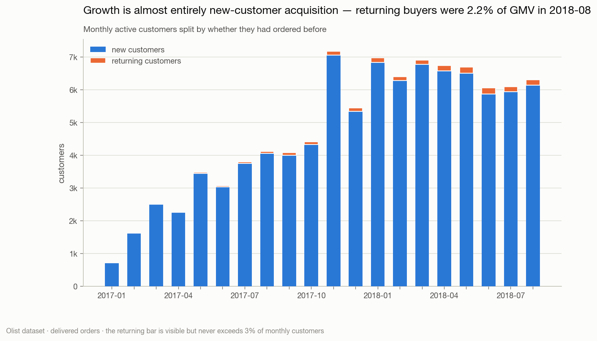
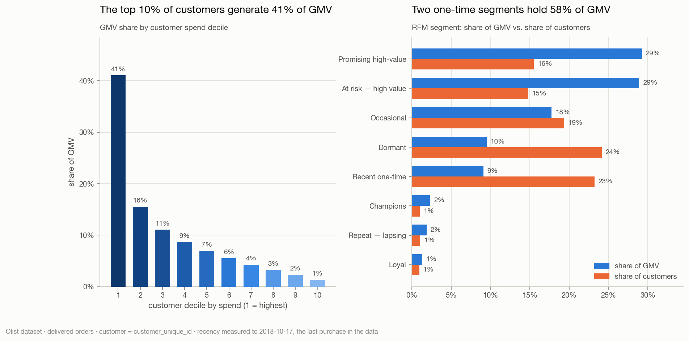
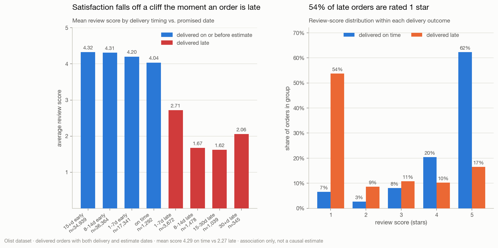
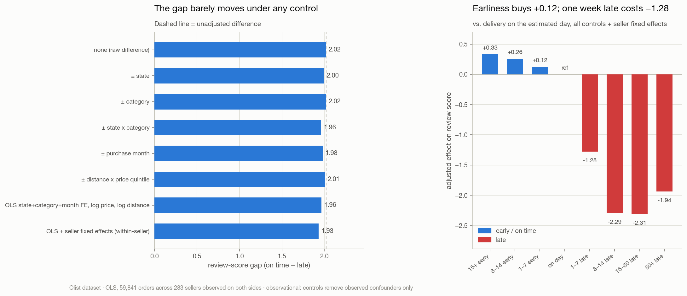
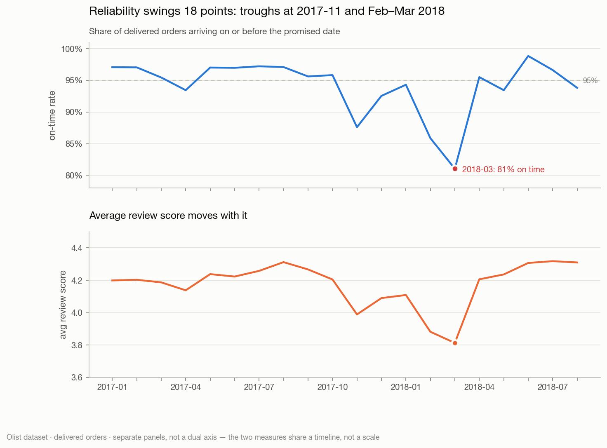
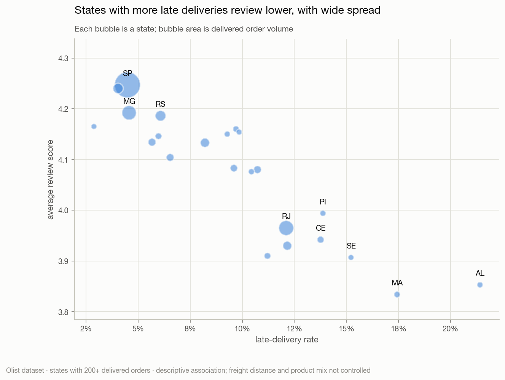
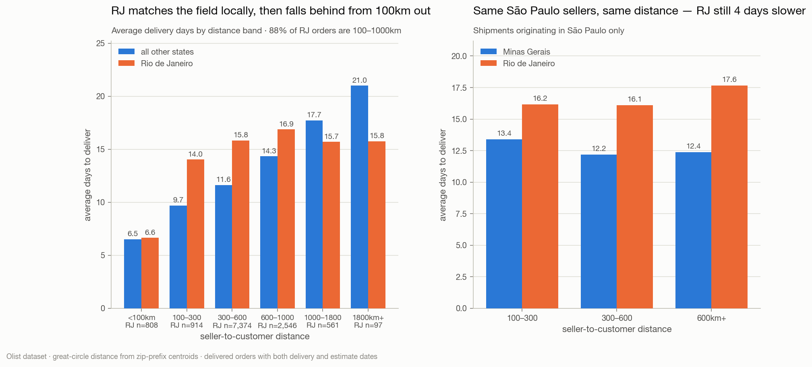
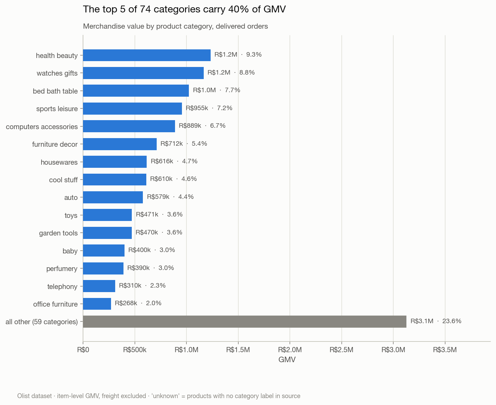
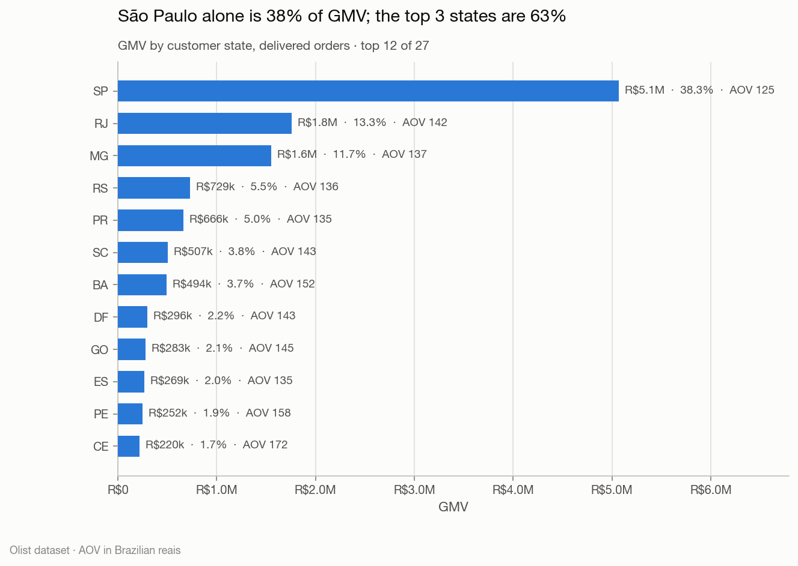

# 🛒 E-Commerce Revenue & Customer Analytics

### End-to-End Business Analytics | SQL • Python • Power BI

**By Ali Naraqi** · Data Analytics · Business Intelligence · Customer Analytics

> **Status:** Analysis complete and reproducible. SQL layer, Python EDA, RFM
> segmentation, figures, controlled robustness tests, an interactive dashboard
> and the written report are finished and verified. The Power BI `.pbix` and its
> screenshots are **not** included — see [BI layer](#-bi-layer).

### 📊 **[Open the interactive dashboard →](https://claude.ai/code/artifact/35540dfb-e73e-4ddf-a023-9d0d5373b71e)**

Five tabs, hover tooltips on every chart, a table view behind each one, and
light/dark themes. Built from the same `outputs/` tables the report cites.

## 📌 Overview

How does an online marketplace understand what drives revenue, identify valuable
customers, and improve the shopping experience?

I analysed the **Brazilian E-Commerce Public Dataset by Olist** — ~100k orders
across 2016–2018 — to answer seven business questions with SQL, Python and a
fully specified BI model. Every number in this README is generated by
`scripts/run_analysis.py` and written to `outputs/`; none of it is typed by
hand, so the documentation cannot drift from the analysis.

**Headline:** the marketplace tripled order volume across 2017, then plateaued
through 2018 *while still acquiring customers at full rate*. At most 3% of
customers ever order twice. Separately, delivery reliability swings between 81%
and 99% on-time month to month, and late orders average 2.27 stars against 4.29
for on-time ones.

📄 **[Read the full executive summary →](reports/executive_summary.md)**
📊 **[Open the interactive dashboard →](https://claude.ai/code/artifact/35540dfb-e73e-4ddf-a023-9d0d5373b71e)**

## 🚀 Reproduce it

```bash
# 1. Download the 9 Olist CSVs from Kaggle into archive/  (see data/README.md)
pip install -r requirements.txt

python scripts/build_db.py                          # CSVs -> data/olist.db        (~15s)
sqlite3 data/olist.db < sql/00_analytical_tables.sql  # base tables + grain contract (~4s)
sqlite3 data/olist.db < sql/01_data_validation.sql    # 8 data-quality gates
python scripts/run_analysis.py                      # -> outputs/tables, figures   (~18s)
python scripts/build_distance.py                    # geolocation -> order_distance (~20s)
python scripts/run_controls.py                      # controlled tests of 2 claims  (~60s)
python scripts/export_powerbi_model.py              # -> dashboard/model/*.csv
```

The SQL files run top to bottom in numeric order; `00` must come first, since
every later script reads the tables it builds. `run_analysis.py` re-runs `00`
itself, so a stale database can never feed the figures.

```bash
sqlite3 data/olist.db < sql/02_sales_kpis.sql         # optional: KPI queries by hand
sqlite3 data/olist.db < sql/03_customer_analytics.sql
sqlite3 data/olist.db < sql/04_delivery_satisfaction.sql
```

Then open `notebooks/` for the narrated analysis, or
`reports/executive_summary.md` for the findings.

## 📊 Key performance indicators

Delivered orders, Sep 2016 – Oct 2018. Full output in
[`outputs/kpis.json`](outputs/kpis.json).

| KPI | Value | Definition |
| --- | ---: | --- |
| Delivered orders | **96,478** | distinct `order_id`, status `delivered` |
| GMV | **R$13,221,498** | `SUM(order_items.price)`, freight excluded |
| Freight | R$2,198,276 | 14.3% of total customer spend, reported separately |
| Average order value | **R$137.04** | GMV ÷ delivered orders |
| Items per order | 1.14 | 90% of orders contain exactly one item |
| Active customers | **93,358** | distinct `customer_unique_id` |
| Repeat purchase rate | **3.0%** | customers with >1 delivered order |
| On-time delivery rate | **93.2%** | delivered on/before estimate ÷ delivered with both dates |
| Average days to deliver | 12.6 | purchase → customer delivery |
| Average review score | **4.16** | mean at order grain |

> **GMV is not revenue.** This dataset has no commission rate, product cost or
> marketing spend. No margin, profit, ROI or true customer-lifetime-value claim
> can be made from it — and none is made here.

## 🎯 Business questions → findings

| # | Question | Finding | Recommended action |
| --- | --- | --- | --- |
| 1 | How do orders and revenue change by month, state and category? | GMV grew 8.8× to a Nov 2017 peak, then flat through 2018. São Paulo is 38% of GMV; the top 3 states are 63%. | Treat 2018 as a plateau, not growth; diversify beyond the SP corridor |
| 2 | Which products and categories drive GMV? | Top 5 of 74 categories = 40% of GMV (health & beauty 9.3%, watches & gifts 8.8%, bed/bath/table 7.7%, sports 7.2%, computer accessories 6.7%) | Concentrate merchandising and bundling in the top 5 |
| 3 | What is AOV and how does it move? | R$137.04, range R$124–149 across 20 months — no trend | Pursue attach rate (1.14 items/order), not price |
| 4 | How do new and repeat customers differ? | Repeat buyers are worth 1.9× (R$260 vs R$138) but are only 3.0% of customers; returning buyers = 2.2% of monthly GMV | Build the retention programme that does not currently exist |
| 5 | How often are deliveries late? | 6.8% overall — but monthly on-time ranges 81%–99% | Manage variance with weekly control limits, not an annual average |
| 6 | Is delivery performance associated with review scores? | Strongly, and robustly: on-time 4.29 vs late 2.27. The gap holds at **−1.93** within the same seller, state, category and month | Protect against lateness — still observational, but not explained by geography, product mix or seller quality |
| 7 | Which segments offer the best retention opportunity? | Two *one-time* high-value segments hold 58% of GMV; the loyal core is 3% of customers | Target "Promising high-value" (recent, 29% of GMV) first |

## 📈 Findings

### Growth is acquisition-only, and it stalled in 2018



GMV grew from R$112k (Jan 2017) to R$988k (Nov 2017), then moved sideways for
all of 2018. Returning customers never exceeded 2.96% of monthly GMV.



### The valuable customers are one-time buyers



The top 10% of customers generate 41% of GMV — but with a 3% repeat rate, that
concentration reflects basket size, not loyalty. "Promising high-value" and
"At risk — high value" are both single-purchase segments and together hold 58%
of GMV. The classic loyal core is 3.0% of customers and 5.5% of GMV.

### Lateness collapses satisfaction — a cliff, not a slope



Review scores fall from 4.04 on the estimated day to 2.71 at 1–7 days late.
Arriving 15+ days early scores 4.32 against 4.20 for 1–7 days early — earliness
buys very little, while a single day late costs a great deal.

**The gap survives controls.** The obvious objection — that late deliveries
just concentrate in distant states, heavier categories or bad sellers — was
tested. The raw 2.02-point gap moves to 2.00 adjusting for state, 2.02 for
category, 1.96 for state × category, 2.01 for distance × price, and **1.93
under OLS with seller fixed effects** (59,841 orders, 283 sellers, 95% CI
−1.97 to −1.89). Under those controls, 1–7 days early is worth **+0.12** and
1–7 days late is worth **−1.28** — a 10:1 asymmetry.



*Still observational: controls remove observed confounders only.*

### Reliability is a variance problem



### Rio de Janeiro is the largest single operational problem



RJ produces **23% of all late deliveries from 12.8% of orders** — a 12.1% late
rate against São Paulo's 4.5%, and 15.3 days to deliver against SP's 8.8.

**Distance was tested, not assumed** — and the test corrected an earlier draft.
RJ orders average 490km against SP's 251km, so RJ *is* further and the
comparison must be made within distance bands. Doing that: RJ matches the
national field on local delivery (**6.6 vs 6.5 days under 100km**) and then
falls behind from 100km out. Holding seller origin constant too — São Paulo
sellers only, 300–600km — RJ takes **16.1 days at a 13.8% late rate against
Minas Gerais' 12.2 days and 5.4%**.

Same sellers, same distance, different destination. This is a destination-side
problem: line-haul or regional carrier handoff into RJ, not geography, not
seller mix.



### Category and regional concentration




## 🗂️ Repository

```text
├── archive/                      # raw Olist CSVs (not committed — see data/README.md)
├── data/
│   ├── README.md                 # download + build instructions
│   └── olist.db                  # generated SQLite database
├── sql/
│   ├── 00_analytical_tables.sql  # grain contract, eligibility rule, base tables
│   ├── 01_data_validation.sql    # 8 data-quality gates
│   ├── 02_sales_kpis.sql         # GMV, AOV, category, geography, payment mix
│   ├── 03_customer_analytics.sql # repeat behaviour, cohorts, RFM
│   └── 04_delivery_satisfaction.sql
├── scripts/
│   ├── build_db.py               # CSVs -> typed SQLite
│   ├── viz_theme.py              # shared chart theme (validated palette)
│   ├── run_analysis.py           # SQL -> outputs/tables + outputs/figures
│   ├── build_distance.py         # geolocation -> seller→customer distance
│   ├── run_controls.py           # controlled tests of the two headline claims
│   └── export_powerbi_model.py   # -> dashboard/model star schema
├── notebooks/
│   ├── 01_data_quality_eda.ipynb
│   └── 02_customer_analysis.ipynb
├── outputs/
│   ├── kpis.json                 # machine-written headline numbers
│   ├── controls.json             # results of the controlled tests
│   ├── tables/                   # 24 result CSVs
│   └── figures/                  # 10 PNGs
├── dashboard/
│   ├── interactive_dashboard.html # published interactive dashboard
│   ├── measures.dax              # 38 Power BI measures
│   ├── powerbi_build_guide.md    # model, relationships, pages, validation
│   └── model/                    # generated star schema (not committed)
├── reports/
│   └── executive_summary.md      # findings + recommendations
└── requirements.txt
```

## 🧰 Method

### Grain and eligibility — the two decisions everything rests on

`sql/00_analytical_tables.sql` defines three base tables with an explicit grain
contract: one row per order, per order line, per customer. I aggregate money to
order grain **before** any other join, because `orders ⋈ order_items` fans out
and would otherwise multiply GMV.

**Eligibility: `order_status = 'delivered'`** — 97.0% of orders, and the only
status with complete money *and* delivery timestamps. I report the looser
alternatives rather than just asserting this one: the widest adds 2.8% to GMV
and R$0.71 to AOV, so no conclusion depends on the choice.

### Three traps this dataset sets, and how I handled them

1. **`customer_id` is not a customer.** It is regenerated per order. Keying
   retention on it returns a **0.00% repeat rate** — a query that runs fine and
   produces a plausible, wrong number. All customer metrics use
   `customer_unique_id`.
2. **`review_id` is not unique** (789 reused) and 547 orders carry multiple
   reviews. Reviews are collapsed to order grain before joining.
3. **Sparse months at both ends.** 2016-09/10/12 are a pilot trickle and
   2018-09/10 are truncated mid-collection. Charting them produces a dramatic
   fake collapse, so all trends use 2017-01 … 2018-08.

### Testing the claims that could not be settled by description

I first reported two findings with caveats rather than evidence. Rather than
leave them there, `scripts/build_distance.py` and `scripts/run_controls.py` go
back and test them.

**"RJ is slow for reasons other than distance."** The `geolocation` table —
1M rows, unused by the rest of the analysis — gives a median lat/lng centroid
per zip prefix (median, not mean: 42 points geocode outside Brazil entirely).
Haversine distance between seller and customer covers 99.5% of delivered
orders. The test **corrected my original claim**: RJ averages 490km against
SP's 251km, so the two are *not* comparable distances, and I had no business
saying they were. Within distance bands, and holding seller origin constant,
the RJ effect turns out larger than I first reported and clearly
destination-side.

**"Late delivery is associated with a 2.0-point review drop."** Tested by
stratification (state, category, month, distance × price) and by OLS with
state, category, month and seller fixed effects. Seller fixed effects are
identified only on the 283 sellers observed with ≥30 orders and ≥5 on each side
of the outcome — otherwise the dummy absorbs the variation being measured.
The estimate moves from −2.02 to −1.93.

Both remain observational: controls remove observed confounders only.

### Validation

`sql/01_data_validation.sql` runs 8 gate groups before any KPI is trusted. The
strongest is an independent reconciliation: payments and item lines are recorded
separately in the source and agree to **R$2,870 on R$15.8M (0.02%)** — evidence
that the join grain is right, since a fan-out bug would show tens of percent.

Also handled: 775 item-less orders (excluded by eligibility), 8 delivered orders
with no delivery date (set `NULL`, not counted as late), 610 products with no
category and 2 missing translations (patched; rest mapped to `unknown`).

### RFM — one deliberate departure from the textbook

Recency and Monetary use `NTILE(5)` quintiles. **Frequency does not.** With 97%
of customers at exactly one order, frequency quintiles are degenerate — `NTILE`
would split tied customers across score boundaries by row order, giving two
identical one-time buyers different scores. Frequency uses a business rule
instead (`1→1, 2→3, 3→4, 4+→5`), which is reproducible and interpretable.

## 📉 BI layer

**The interactive dashboard is live: [open it here](https://claude.ai/code/artifact/35540dfb-e73e-4ddf-a023-9d0d5373b71e)** — five tabs
(Overview, Customers, Products & Regions, Delivery & Satisfaction, Evidence &
Controls), hover tooltips, per-chart table views, and both themes. Source:
[`dashboard/interactive_dashboard.html`](dashboard/interactive_dashboard.html).

**The Power BI `.pbix` and its screenshots are not in this repo.** Power BI
Desktop is Windows-only and this analysis was built on macOS, so that file could
not be authored or captured here. Everything upstream of it is finished:

- **[`dashboard/model/`](dashboard/)** — a tested 6-table star schema
  (2 facts, 4 dimensions incl. a contiguous date table), generated by
  `scripts/export_powerbi_model.py`. Loading the 9 raw CSVs instead would give
  Power BI an ambiguous snowflake in which measures silently fan out.
- **[`dashboard/measures.dax`](dashboard/measures.dax)** — 38 measures, each
  reproducing a number already verified in SQL, with the eligibility filter
  inside the measure so two pages cannot disagree.
- **[`dashboard/powerbi_build_guide.md`](dashboard/powerbi_build_guide.md)** —
  relationships, the mark-as-date-table step, page-by-page layout, and a
  validation table of 9 expected values to check before building any visual.

The remaining work is roughly an hour in Power BI Desktop. The interactive
dashboard above and the ten figures in `outputs/figures/` carry the same
findings in the meantime.

## ✅ Definition of done

- [x] Data downloaded and schema documented
- [x] Key uniqueness, missingness and joins validated (8 gate groups)
- [x] SQL queries and KPI definitions reviewed
- [x] Python EDA completed (2 executed notebooks)
- [x] RFM segmentation completed
- [x] Findings supported with numbers and charts
- [x] Headline claims tested against controls (distance, seller, state, category)
- [x] Reproduction steps tested from a clean environment
- [x] Power BI model, measures and build guide specified
- [x] Interactive dashboard built and published — [link](https://claude.ai/code/artifact/35540dfb-e73e-4ddf-a023-9d0d5373b71e)
- [ ] Power BI `.pbix` built — *blocked: requires Windows*
- [ ] Power BI screenshots published — *blocked by the above*

## ⚠️ Limitations

1. **GMV is not revenue.** No commission, cost or marketing data exists here.
2. **No causal identification.** All relationships are observational. The
   delivery–satisfaction association is strong and dose-responsive but
   uncontrolled for state, category, price and seller.
3. **Retention is censored.** A ~21-month window understates repeat purchasing;
   3.0% is a lower bound, not a point estimate.
4. **True CLV is not computable** — no costs, and a censored window.
5. **Historical sample** (2016–2018). It does not describe current operations.
6. **Reviews are self-selected**, though coverage is unusually high at 99.3% of
   delivered orders.
7. **Eligibility is a judgement call.** Delivered-only was chosen and its
   sensitivity is reported (<2.8% of GMV).

## 📂 Dataset, source and licence

### Source

| | |
| --- | --- |
| **Dataset** | Brazilian E-Commerce Public Dataset by Olist |
| **Collected and released by** | [Olist](https://olist.com), a Brazilian marketplace integrator, which provided the data from its own store operations |
| **Published at** | [kaggle.com/datasets/olistbr/brazilian-ecommerce](https://www.kaggle.com/datasets/olistbr/brazilian-ecommerce) |
| **Coverage** | ~100,000 orders placed 2016-09 to 2018-10 across multiple Brazilian marketplaces |
| **Licence** | Creative Commons Attribution-NonCommercial-ShareAlike 4.0 International (CC BY-NC-SA 4.0) |

**Citation**

> Olist. *Brazilian E-Commerce Public Dataset by Olist* [Data set]. Kaggle.
> https://www.kaggle.com/datasets/olistbr/brazilian-ecommerce

### What the licence requires

CC BY-NC-SA 4.0 is not a public-domain licence, and its three clauses each
carry an obligation that applies to this repository:

- **BY — Attribution.** Olist must be credited and the licence identified
  wherever the data or anything derived from it appears. That is why the
  attribution above sits in the README rather than in a footnote, and why every
  figure in `outputs/figures/` carries a source line naming the dataset.
- **NC — NonCommercial.** The data may not be used for commercial purposes.
  This repository is a portfolio and teaching artefact; the findings describe a
  historical dataset and are not a commercial product or a service offering.
- **SA — ShareAlike.** Derivatives of the data inherit the same licence. The
  CSVs in `outputs/tables/`, the figures in `outputs/figures/`, the
  `dashboard/model/` export and the published dashboard are all derived from
  the dataset, so **they are CC BY-NC-SA 4.0**. The code in `scripts/` and
  `sql/` is my own work and is separable from the data — if you reuse this
  repository, treat the two differently.

I have not added a `LICENSE` file for the code, because the right choice there
depends on how the repository is used; the data's terms above are fixed either
way.

### Provenance and privacy

The data is pseudonymised at source, and that is verifiable from the files
rather than taken on trust:

- Every `customer_id`, `customer_unique_id` and `seller_id` is a 32-character
  hexadecimal hash — no names, emails or account identifiers survive.
- Location is truncated to the **five-digit zip-code prefix** (14,994 distinct
  prefixes for 99,441 customers), not a street address. The `geolocation`
  centroids used for the distance analysis are therefore
  neighbourhood-resolution, which is why distance is treated as a control
  variable and never as a logistics measurement.
- Review text is free-form customer writing. **This analysis uses review
  *scores* only and never the comment text**, so no customer's words are
  reproduced anywhere in this repository.

Nothing in this project attempts to re-identify a customer or seller, and the
grain of the published outputs — state, category, month, segment — is
aggregate throughout.

### Why this dataset

It is one of the few openly licensed e-commerce datasets with **genuinely
relational structure**: nine tables that have to be joined correctly, a real
fan-out trap between orders and order items, an order-key-masquerading-as-a-
customer-key, and delivery timestamps that support an operational question as
well as a commercial one. That makes it a fair test of analytical judgement
rather than of charting.

Its limits are equally real and are listed in full under
[Limitations](#-limitations): no cost or commission data, so no profitability
claim; a ~21-month window, so retention is censored; and 2016–2018 Brazilian
marketplace behaviour, which does not describe any business operating today.

### Table reference

| Table | Rows | Grain |
| --- | ---: | --- |
| `olist_orders_dataset` | 99,441 | one order |
| `olist_order_items_dataset` | 112,650 | one order line |
| `olist_order_payments_dataset` | 103,886 | one payment instalment |
| `olist_order_reviews_dataset` | 99,224 | one review (**not** unique per order) |
| `olist_customers_dataset` | 99,441 | one order's customer record |
| `olist_products_dataset` | 32,951 | one product |
| `olist_sellers_dataset` | 3,095 | one seller |
| `olist_geolocation_dataset` | 1,000,163 | one zip-code point |
| `product_category_name_translation` | 71 | one category |

Download instructions are in [`data/README.md`](data/README.md). The raw CSVs
are deliberately not committed — see [`.gitignore`](.gitignore).

## 📚 References

- [Olist dataset on Kaggle](https://www.kaggle.com/datasets/olistbr/brazilian-ecommerce)
- [pandas](https://pandas.pydata.org/docs/) · [SQLite](https://www.sqlite.org/docs.html) · [Power BI](https://learn.microsoft.com/power-bi/)

---

**Ali Naraqi** — Data Analytics • Business Intelligence • Customer Analytics

Data © Olist, used under CC BY-NC-SA 4.0. Analysis, code and written findings
are my own.
