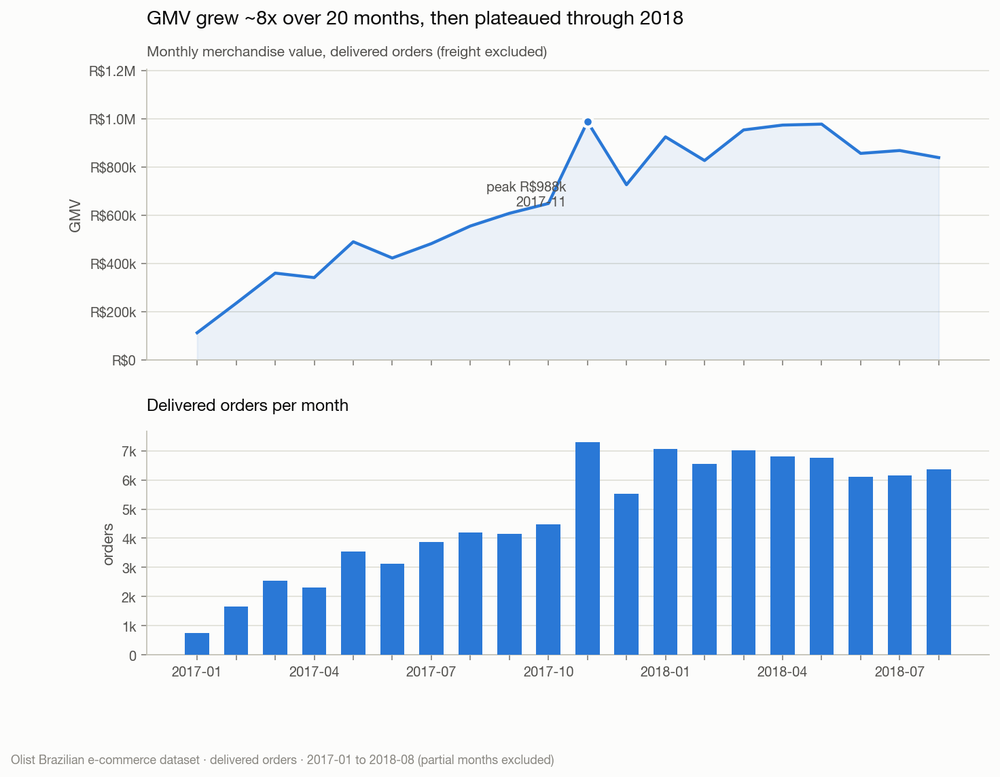
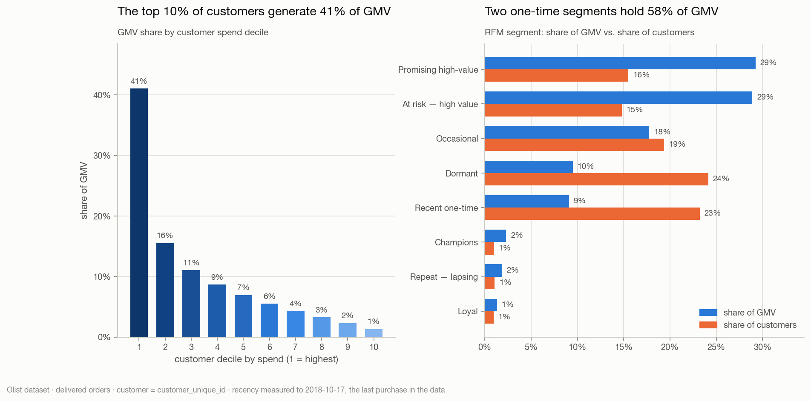
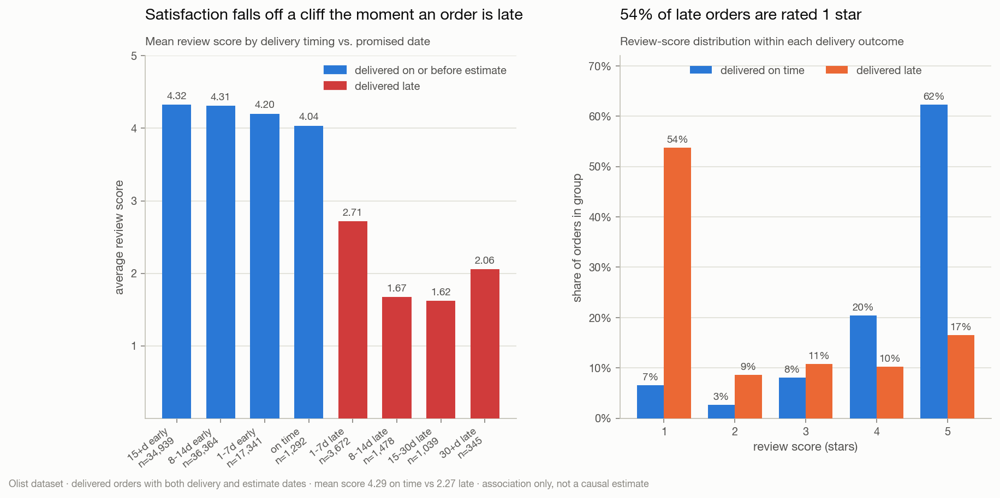
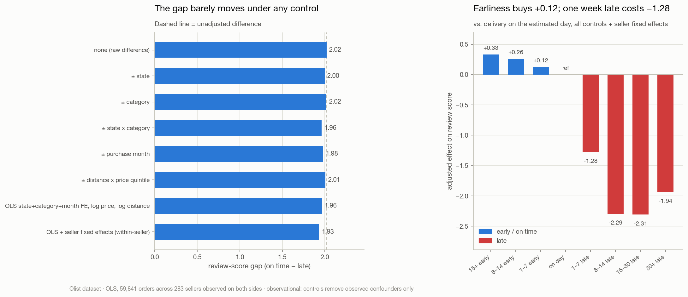
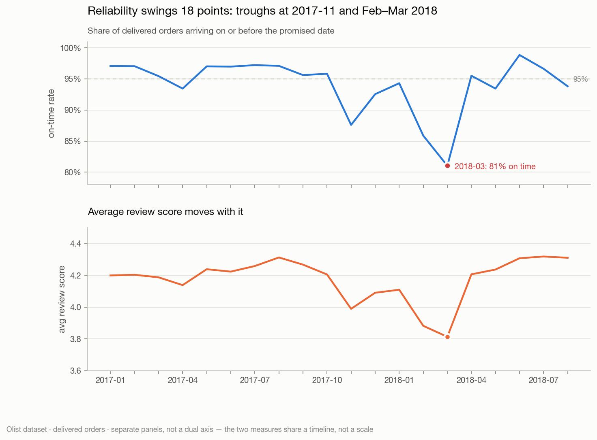
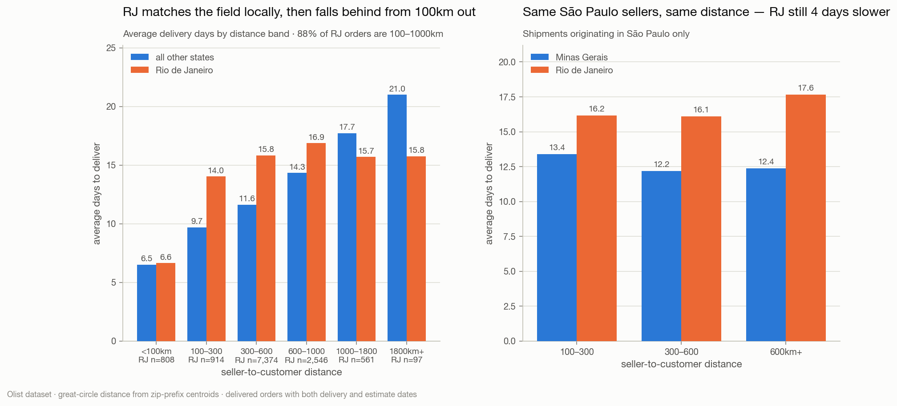
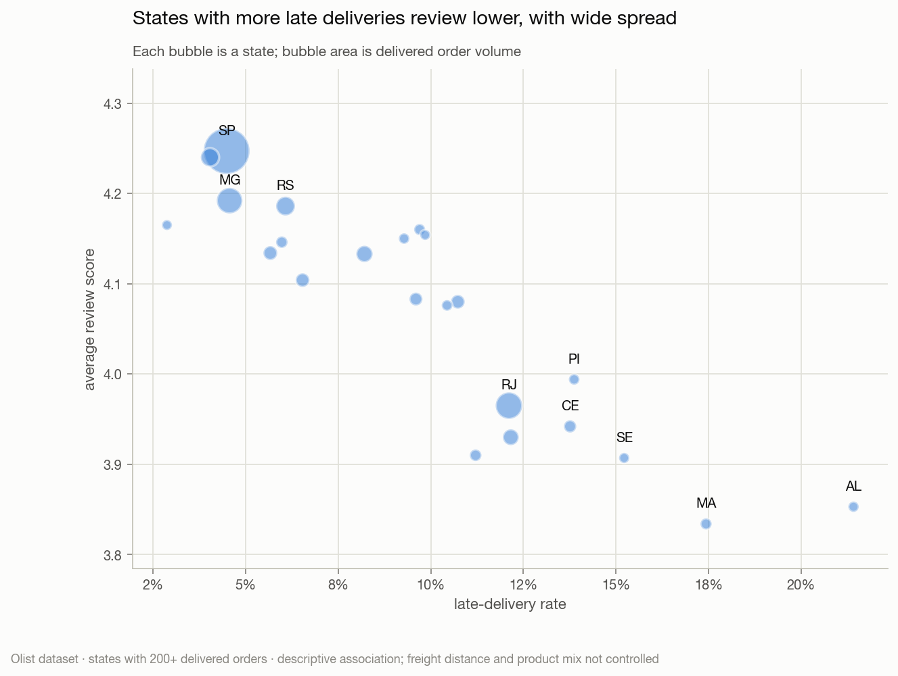

# Executive summary — Olist marketplace analytics

**Scope:** 96,478 delivered orders, Sep 2016 – Oct 2018, Brazilian marketplace.
**Basis:** all figures are delivered orders unless stated. Month-over-month
trends use 2017-01 … 2018-08 (full-coverage months only).
**Source of every number:** `outputs/tables/*.csv`, regenerated by
`python scripts/run_analysis.py`.

> **GMV is not revenue.** All money figures are gross merchandise value — the
> sum of item prices, freight excluded. This dataset contains no commission
> rate, product cost or marketing spend, so no margin, profit, ROI or true
> customer-lifetime-value claim can be made from it, and none is made here.

---

## The headline

The marketplace tripled order volume across 2017 and then **plateaued through
2018 while still acquiring customers at full rate**. That combination has a
single explanation: there is no retention engine. At most 3% of customers ever
place a second order, and returning buyers contribute 2.2% of monthly GMV.

Meanwhile delivery reliability — the strongest correlate of satisfaction in the
data — swings between 81% and 99% on-time month to month, and one state
(Rio de Janeiro) generates 23% of all late deliveries from 13% of orders.

**The two highest-leverage moves are a post-delivery retention programme and a
Rio de Janeiro fulfilment fix.** Neither requires new data.

---

## Key performance indicators

| KPI | Value |
| --- | --- |
| Delivered orders | 96,478 |
| GMV | R$13,221,498 |
| Freight (reported separately) | R$2,198,276 — 14.3% of total spend |
| Average order value | R$137.04 |
| Items per order | 1.14 |
| Active customers | 93,358 |
| Repeat purchase rate | 3.0% |
| On-time delivery rate | 93.2% |
| Average days to deliver | 12.6 |
| Average review score | 4.16 |

Choice of eligibility basis moves GMV by under 2.8% and AOV by under R$0.71;
no conclusion below depends on it.

---

## Five findings

### 1. Growth is acquisition-only, and it has stalled

GMV grew 8.8× from Jan 2017 (R$112k) to its Nov 2017 peak (R$988k), then
moved sideways for the whole of 2018 — R$953k in March against R$839k in August.
Across that plateau, returning customers never exceeded **2.96%** of monthly GMV.

The business was adding customers the entire time. It simply never got them back.

**Caveat:** the ~21-month window censors retention — a customer acquired in
July 2018 has weeks to return, not months. 3% is a floor. The *direction* is
not in doubt, but the true long-run rate is higher than 3%.

### 2. The valuable customers are one-time buyers, not loyalists

RFM segmentation returns an unusual shape, and the shape is the finding:

| Segment | Customers | % of GMV | GMV/customer | Avg orders |
| --- | ---: | ---: | ---: | ---: |
| Promising high-value | 15.5% | 29.2% | R$267 | 1.0 |
| At risk — high value | 14.8% | 28.9% | R$277 | 1.0 |
| Occasional | 19.4% | 17.8% | R$130 | 1.0 |
| Dormant | 24.1% | 9.5% | R$56 | 1.0 |
| Recent one-time | 23.2% | 9.1% | R$55 | 1.0 |
| Champions + Loyal + Repeat-lapsing | **3.0%** | **5.5%** | R$190–328 | ~2.1 |

**Two single-purchase segments hold 58% of GMV.** The loyal core that a standard
retention programme targets is 3% of customers and 5.5% of GMV — it barely
exists. The only thing separating "Promising" from "At risk" is recency: one
group bought ~4 months ago, the other ~14.

The top 10% of customers by spend generate **41% of GMV**, but because almost
nobody buys twice, that concentration reflects *basket size*, not loyalty.

### 3. Lateness destroys satisfaction, and it is a cliff

| Delivery outcome | Orders | Avg review | 1–2 star | 4–5 star |
| --- | ---: | ---: | ---: | ---: |
| On time | 89,443 | **4.29** | 9.2% | 82.6% |
| Late | 6,381 | **2.27** | 62.4% | 26.7% |

**54% of late orders are rated 1 star**, against 7% of on-time orders. The
collapse is immediate rather than gradual — 4.04 on the estimated day, 2.71 at
1–7 days late. Being one day late costs more than a week of earliness earns:
arriving 15+ days early scores 4.32 against 4.20 for 1–7 days early.

**The gap survives every control available.** The obvious objection is
confounding — late orders concentrate in distant states, heavier categories and
particular sellers, any of which could independently depress scores. Tested
directly, the raw 2.02-point gap barely moves:

| Adjustment | Gap |
| --- | ---: |
| none (raw difference) | 2.02 |
| stratified by state | 2.00 |
| stratified by category | 2.02 |
| stratified by state × category | 1.96 |
| stratified by purchase month | 1.98 |
| stratified by distance × price quintile | 2.01 |
| OLS: state + category + month fixed effects, log price, log distance | 1.96 |
| **OLS + seller fixed effects (within-seller)** | **1.93** |

The strictest test compares *the same seller's* on-time and late orders, within
the same state, category and month, at similar price and distance: **−1.93
points (95% CI −1.97 to −1.89), across 59,841 orders from 283 sellers.**

Under those controls the asymmetry is stark: arriving 1–7 days early is worth
**+0.12**, arriving 1–7 days late is worth **−1.28** — roughly a 10:1 penalty.

**Still observational.** Controls remove *observed* confounders only; an
unobserved one — a seller's bad batch that ships late *and* arrives defective —
remains possible. What they do rule out is the standard objection that this is
just geography, product mix or seller quality in disguise. Reverse causation is
implausible (a review cannot retro-date a delivery). Treat this as a robust
association that behaves the way a causal relationship would, not as a
randomised effect estimate.

### 4. Reliability is a variance problem, not a level problem

93.2% on-time looks healthy. The monthly series does not: it ranges from
**98.8% (Jun 2018) to 81.0% (Mar 2018)**, an 18-point swing. Three months —
Nov 2017, Feb 2018, Mar 2018 — carry a disproportionate share of all late
deliveries. Nov 2017 is Black Friday; Feb–Mar 2018 has no visible seasonal
cause in this data.

Average review score tracks the same shape, bottoming at 3.81 in the worst month.

Note also that orders arrive on average **11.9 days before** the promised date,
against a 12.6-day actual delivery time. The estimate is heavily padded — which
protects the on-time metric but means the published promise carries little
information for the customer.

### 5. Rio de Janeiro is the single largest operational problem

| State | Delivered | Late | Late rate | Avg days | Avg review |
| --- | ---: | ---: | ---: | ---: | ---: |
| SP | 40,494 | 1,820 | 4.5% | 8.8 | 4.25 |
| **RJ** | **12,350** | **1,495** | **12.1%** | **15.3** | **3.97** |
| MG | 11,354 | 519 | 4.6% | 12.0 | 4.19 |
| BA | 3,256 | 396 | 12.2% | 19.3 | 3.93 |
| RS | 5,344 | 325 | 6.1% | 15.3 | 4.19 |

**RJ produces 23% of all late deliveries from 12.8% of orders** — a late rate
nearly triple São Paulo's, and the lowest review score of any high-volume state.

**Distance does not explain it — tested, not assumed.** An earlier draft
asserted this from average delivery days alone, which is not evidence. Using
zip-prefix centroids from the previously unused geolocation table, RJ orders
average **490km against SP's 251km** — RJ genuinely *is* further, so the
comparison has to be made *within* distance bands:

| Distance band | RJ days | Other states | RJ late % | Other late % | RJ orders |
| --- | ---: | ---: | ---: | ---: | ---: |
| <100km | 6.6 | 6.5 | 5.3% | 4.4% | 808 |
| 100–300km | 14.0 | 9.7 | 9.6% | 4.9% | 914 |
| 300–600km | 15.8 | 11.6 | 13.2% | 4.8% | 7,374 |
| 600–1000km | 16.9 | 14.3 | 12.9% | 6.1% | 2,546 |

**RJ matches the national field exactly on local delivery (6.6 vs 6.5 days),
then falls behind from 100km out.** The tightest test holds seller origin
constant as well — São Paulo sellers only, same distance band, RJ vs Minas
Gerais:

| Band | MG days | RJ days | MG late % | RJ late % |
| --- | ---: | ---: | ---: | ---: |
| 100–300km | 13.4 | 16.2 | 7.2% | 13.2% |
| 300–600km | 12.2 | 16.1 | 5.4% | 13.8% |
| 600km+ | 12.4 | 17.6 | 3.6% | 17.1% |

Same sellers, same distance, different destination: **RJ is 4–5 days slower and
2.5–4× more likely to be late.** This is a destination-side effect — line-haul
or regional carrier handoff into RJ — not geography and not seller mix.

*Caveat: in the 1000km+ bands RJ is faster than the field, but those hold under
700 RJ orders between them and compare against the remote states that dominate
long-haul. 88% of RJ volume sits in the 100–1000km range where RJ trails.*

---

## Recommendations

Ordered by impact **per unit of effort**, not by raw size — note that this puts
the largest single prize (attach rate, #4, ≈9% GMV) below the cheapest one
(retention, #1, ≈2% GMV). Each recommendation states what would prove it worked,
because none of them is established by this observational data alone.

### 1. Launch a 30-day post-delivery retention programme — highest leverage

**Why:** retention is effectively absent (≤3%), and among customers who *do*
return, **half come back within 30 days**. The window is short and currently
unused. Target "Promising high-value" first (15.5% of customers, 29% of GMV,
recently active) before attempting to win back the "At risk" block, which has
been quiet for ~14 months and is a much harder sell.

**Caution:** the second order averages R$124 against a R$138 first order, so
size any incentive against R$124, not R$138.

**Test:** randomised holdout. Measure 90-day repeat rate in treated vs control.

**Sizing, with the arithmetic shown.** Today's 2,801 repeat customers place
3,120 orders beyond their first, at a R$123 repeat AOV — R$384k of GMV across
the 21-month window. Doubling the repeat rate from 3% to 6% roughly doubles
that: **≈R$55k per quarter, a 2.1% lift** on recent quarterly GMV of R$2.56M.

That is a real but modest number, and it is worth being clear about: no
plausible retention programme rescues a plateau on its own. It is ranked first
because it is the cheapest lever, the only one with no current owner, and the
one whose upside compounds — not because it closes the gap by itself.

### 2. Fix Rio de Janeiro fulfilment

**Why:** 1,495 late orders, 23% of the national total, from 12.8% of orders,
with the lowest review score among high-volume states — and the gap survives
controls for both distance and seller origin.

**Do:** the distance and seller-origin controls narrow this to a
*destination-side* problem — RJ's local delivery already matches the national
field, so the failure is in line-haul or regional carrier handoff, not last mile
and not seller mix. Start with carrier performance on SP→RJ lanes, where the
volume is.

**Test:** bring RJ's late rate from 12.1% toward MG's 4.6%. That removes ~900
late orders per period, the group that currently rates 2.27 stars.

### 3. Manage delivery variance, not the annual average

**Why:** a 93% annual KPI conceals an 81%–99% monthly range, and the worst
months drive the worst reviews.

**Do:** report on-time rate weekly with a control limit; pre-stage capacity for
known peaks (Nov 2017 shows Black Friday is a predictable failure). Investigate
Feb–Mar 2018 specifically — an unexplained 18-point degradation is a repeatable
risk until its cause is known.

### 4. Raise attach rate rather than discounting

**Why:** 90% of delivered orders contain exactly one item and the mean is 1.14.
AOV has been flat at R$124–149 for 20 months. There is far more headroom in
second-item attach than in price.

**Do:** bundle and cross-sell inside the top five categories (health & beauty,
watches & gifts, bed/bath/table, sports & leisure, computer accessories —
together 40% of GMV).

**Test:** items per order from 1.14 to 1.25, holding order volume and price
per item (R$120) constant, adds 10,400 items — **+R$1.25M, a 9.4% GMV lift**.
Materially larger than the retention prize, though it assumes the marginal item
sells at the current average price, which bundling may not achieve.

### 5. Investigate office furniture fulfilment

**Why:** 20.7 days average delivery against a 12.6-day overall mean, and the
lowest review score of any sizeable category (3.65). Small volume (1,251 orders)
but an unambiguous outlier — likely a bulky-goods handling problem.

---

## Limitations

1. **GMV is not revenue.** No commission, cost or marketing data exists in this
   source. No profitability, margin or ROI claim can be made.
2. **No causal identification.** Every relationship here is observational.
   The delivery–satisfaction association is now controlled for state, category,
   month, price, distance and seller identity and survives at −1.93, but
   controls address *observed* confounders only. Robust association, not a
   randomised effect estimate.
3. **Retention is censored.** A ~21-month window understates repeat purchasing;
   3% is a lower bound.
4. **True CLV is not computable.** Without costs and with a censored window,
   `gmv_per_customer` is observed historical spend, not lifetime value.
5. **Historical sample.** 2016–2018 Brazilian marketplace data. It does not
   describe current operations.
6. **Review scores are self-selected.** 99.3% of delivered orders have a review,
   which is unusually high, but respondents are still not a random sample.
7. **Eligibility is a judgement call.** Delivered-only was chosen and the
   sensitivity is reported (<2.8% of GMV); other analysts may reasonably choose
   differently.

---

**Interactive dashboard:** https://claude.ai/code/artifact/35540dfb-e73e-4ddf-a023-9d0d5373b71e

*Reproduce: `python scripts/build_db.py && python scripts/run_analysis.py`.
Validation: `sqlite3 data/olist.db < sql/01_data_validation.sql`.*
